<div align="center">
  
</div>

<p align="center">
  <a href="https://diufoundry.online"></a>
  
  
</p>

# DIU NEST

**Make procurement decisions easier to inspect.**

DIU NEST explores how a procurement team could organise supplier information, supporting evidence, risk factors, and decision notes in one focused workspace. It is a product prototype for evidence-aware review flows rather than a verified supplier-data service.

## The workflow

- **Supplier records:** Keep the key details of a supplier organised in a consistent interface.
- **Evidence references:** Attach or reference supporting material while reviewing a claim.
- **Cost and risk review:** Compare decision factors and inspect the reasoning presented by the UI.
- **Decision notes:** Capture review and sign-off steps in a clearer workflow.

## A prototype view of the system

```text
Supplier records
       │
       ▼
Evidence references
       │
       ▼
Cost / risk review UI
       │
       ▼
Decision notes and review history
```

## Stack

Next.js · React · TypeScript · Tailwind CSS · Framer Motion · Zod

## Run locally

**Requirements:** Node.js and npm (or a compatible package manager).

```bash
git clone https://github.com/Kishordiu/Diu-Nest.git
cd Diu-Nest
npm install
npm run dev
```

For a production build:

```bash
npm run build
npm start
```

## Prototype boundary

The current package does not include a dedicated database client or cryptographic signing service. Do not assume that supplier documents have been independently verified, that an audit trail is cryptographically signed, or that collaboration is live across multiple users. Validate the storage model, scoring formulas, permission boundaries, and external records before using this project for real procurement decisions or sensitive supplier information.

---

<p align="center"><sub>DIU FOUNDRY · PRODUCT / SYSTEMS / EVIDENCE</sub></p>
